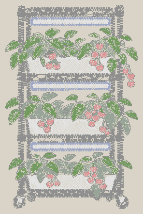
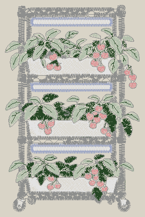
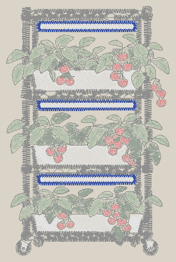
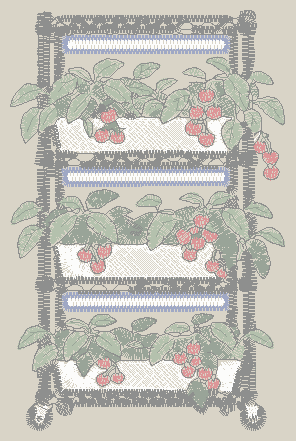
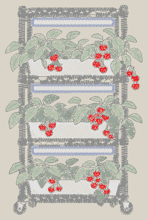
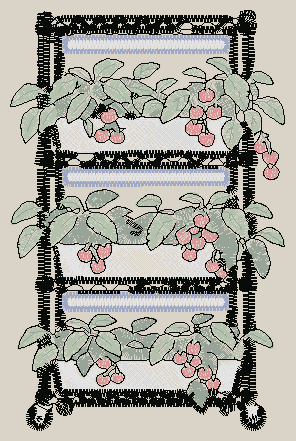

# Stitching procedure: tomato rack

## 1. Before you start

1. [ ] Design: tomato rack. Final size 78.6 x 120.3 mm (3.09 x 4.74 in).

2. [ ] Hoop: use the 280x200 hoop (280 x 200 mm), mounted as labelled. The design leaves 40 mm to the nearest hoop edge (minimum 10 mm).

3. [ ] Totals: 26899 stitches, 6 thread colours, 5 thread changes. Estimated time about 55 min (45 min sewing at 600 spm plus about 2 min per thread change).

4. [ ] Shopping and prep list:
    - Thread 1: olive (#739a5f), suggested Madeira Polyneon 1968 Fair Green.
    - Thread 2: dark green (#264725), suggested Robison-Anton Polyester 5849 Blue Spruce.
    - Thread 3: royal blue (#3953a4), suggested Isacord Polyester 3332 Forget Me Not.
    - Thread 4: white (#fcfcfb), suggested Isacord Polyester 0015 White.
    - Thread 5: red (#e92024), suggested Isacord Polyester 1704 Candy Apple.
    - Thread 6: black (#090b09), suggested Isacord Polyester 0020 Black.
    - Bobbin thread: 60 wt pre-wound, white (light fabric; the back of the embroidery shows the bobbin colour).
    - Needle: 75/11 embroidery needle (sharp point); 90/14 on heavy canvas or denim. Start every project with a fresh needle.
    - Stabilizer: One layer of medium-weight tear-away under the fabric (two layers on light cotton or linen). Heavy canvas or denim is stable enough on its own with one layer.
    - Temporary spray adhesive (505 or similar) if the garment cannot be hooped and must be floated.
    - Small curved embroidery scissors for jump threads, a seam ripper, and a lint brush.

5. [ ] File transfer: copy design.dst to a USB stick (FAT32) in a folder you will recognise, or send it with the Poolin Wi-Fi app (InStitch). Name it clearly, for example tomato_rack_79mm.dst, so it is easy to find on the touchscreen.

## 2. Hooping

1. [ ] Decide where the design goes on the garment and mark its centre with a water-soluble pen or a pin. The design is centred on the hoop origin, so this mark is where the needle starts.

2. [ ] Orientation: the design is 79 mm wide and 120 mm tall; the top of the design (negative y in the previews) is the top of the artwork. Mount the hoop as labelled and check on screen that the design is upright relative to the garment before stitching.

3. [ ] Stabilizer: One layer of medium-weight tear-away under the fabric (two layers on light cotton or linen). Heavy canvas or denim is stable enough on its own with one layer. Hoop the fabric with the stabilizer underneath. Drum-tight, grain straight.

4. [ ] Hoop the fabric with the stabilizer underneath: loosen the outer ring, lay the stabilizer then the fabric over the inner ring, press the outer ring down, then tighten. The fabric should be drum-tight but not stretched (pull gently on wovens only).

5. [ ] Line up the hoop's centre marks with your centre mark. Attach the hoop to the machine.

6. [ ] Load design.dst on the machine, check its position on screen, and run the trace/outline function so the foot travels around the design area: confirm it clears the hoop edge and lands where you want it. Adjust and trace again if needed.

7. [ ] Set the speed no higher than about 600 spm for the first run; slow down for small details.

## 3. Thread-by-thread run sheet

One block per colour stop, in sewing order. The machine stops and trims at the end of each colour.

1. [ ] Stop 1 of 6: load olive (#739a5f), Madeira Polyneon 1968 Fair Green. 
    - Thread the needle with this colour before pressing start. Hold the thread tail for the first few stitches.
    - This colour stitches: 12 small shape(s) stitched as satin-style fills (2 to 3 mm across); 47 satin column(s), 0.9 to 2.4 mm wide, 506 mm in total; running-stitch lines, 355 mm in total, for details thinner than 1.5 mm; 5 small patch(es) filling spots the main objects left uncovered.
    - 4536 stitches, about 7.6 min.
    - Watch: Narrow satin columns: watch for thread breaks or shredding; slow the machine if the thread frays.
    - Watch: Small satin-style shapes: check the edges stay crisp and the shape is not pulling narrow.
    - Watch: Outline lines: check they line up with the fills already stitched (registration). If they drift, the fabric slipped in the hoop.
    - Watch: 92 jump(s) inside this colour: trim the floating threads by hand at the stop (upper left 41 mm, upper right 39 mm, upper right 3 mm, centre left 66 mm ...).
    - At the stop: the machine trims the colour automatically; this colour also has 92 jump(s) inside it that the machine does NOT trim. Cut the floating threads on top close to the fabric before continuing.
    - Thread change to stop 2 (dark green): cut the thread near the spool, pull the old thread out forward through the needle (never back up through the tension discs), put on the new spool, thread the path, use the automatic needle threader, and hold the tail for the first stitches.

    

2. [ ] Stop 2 of 6: load dark green (#264725), Robison-Anton Polyester 5849 Blue Spruce. 
    - This colour stitches: 19 small shape(s) stitched as satin-style fills (2 to 3 mm across); 27 satin column(s), 1.1 to 3.4 mm wide, 310 mm in total; running-stitch lines, 527 mm in total, for details thinner than 1.5 mm; 1 small patch(es) filling spots the main objects left uncovered.
    - 3713 stitches, about 6.2 min.
    - Watch: Narrow satin columns: watch for thread breaks or shredding; slow the machine if the thread frays.
    - Watch: Small satin-style shapes: check the edges stay crisp and the shape is not pulling narrow.
    - Watch: Outline lines: check they line up with the fills already stitched (registration). If they drift, the fabric slipped in the hoop.
    - Watch: 98 jump(s) inside this colour: trim the floating threads by hand at the stop (centre 6 mm, centre 4 mm, upper 31 mm, upper 12 mm ...).
    - At the stop: the machine trims the colour automatically; this colour also has 98 jump(s) inside it that the machine does NOT trim. Cut the floating threads on top close to the fabric before continuing.
    - Check registration: the new colour should meet the previous ones without gaps; if it is shifted, re-tension the hoop before going on.
    - Thread change to stop 3 (royal blue): cut the thread near the spool, pull the old thread out forward through the needle (never back up through the tension discs), put on the new spool, thread the path, use the automatic needle threader, and hold the tail for the first stitches.

    

3. [ ] Stop 3 of 6: load royal blue (#3953a4), Isacord Polyester 3332 Forget Me Not. 
    - This colour stitches: 3 satin column(s), 1.8 to 1.8 mm wide, 296 mm in total.
    - 1690 stitches, about 2.8 min.
    - Watch: Narrow satin columns: watch for thread breaks or shredding; slow the machine if the thread frays.
    - Watch: 2 jump(s) inside this colour: trim the floating threads by hand at the stop (upper left 39 mm, lower left 74 mm).
    - At the stop: the machine trims the colour automatically; this colour also has 2 jump(s) inside it that the machine does NOT trim. Cut the floating threads on top close to the fabric before continuing.
    - Check registration: the new colour should meet the previous ones without gaps; if it is shifted, re-tension the hoop before going on.
    - Thread change to stop 4 (white): cut the thread near the spool, pull the old thread out forward through the needle (never back up through the tension discs), put on the new spool, thread the path, use the automatic needle threader, and hold the tail for the first stitches.

    

4. [ ] Stop 4 of 6: load white (#fcfcfb), Isacord Polyester 0015 White. 
    - This colour stitches: 3 tatami fill area(s) totalling 675 mm2 (largest: 282 mm2 upper, 244 mm2 centre, 149 mm2 lower); 3 small shape(s) stitched as satin-style fills (2 to 3 mm across); 7 satin column(s), 2.1 to 4.0 mm wide, 210 mm in total; running-stitch lines, 48 mm in total, for details thinner than 1.5 mm; 3 small patch(es) filling spots the main objects left uncovered.
    - 2968 stitches, about 4.9 min.
    - Watch: Small satin-style shapes: check the edges stay crisp and the shape is not pulling narrow.
    - Watch: Outline lines: check they line up with the fills already stitched (registration). If they drift, the fabric slipped in the hoop.
    - Watch: 25 jump(s) inside this colour: trim the floating threads by hand at the stop (upper right 29 mm, upper 17 mm, lower 71 mm, lower right 32 mm ...).
    - At the stop: the machine trims the colour automatically; this colour also has 25 jump(s) inside it that the machine does NOT trim. Cut the floating threads on top close to the fabric before continuing.
    - Check registration: the new colour should meet the previous ones without gaps; if it is shifted, re-tension the hoop before going on.
    - Thread change to stop 5 (red): cut the thread near the spool, pull the old thread out forward through the needle (never back up through the tension discs), put on the new spool, thread the path, use the automatic needle threader, and hold the tail for the first stitches.

    

5. [ ] Stop 5 of 6: load red (#e92024), Isacord Polyester 1704 Candy Apple. 
    - This colour stitches: 30 small shape(s) stitched as satin-style fills (2 to 3 mm across); 1 satin column(s), 2.2 to 2.2 mm wide, 6 mm in total.
    - 1082 stitches, about 1.8 min.
    - Watch: Small satin-style shapes: check the edges stay crisp and the shape is not pulling narrow.
    - Watch: 28 jump(s) inside this colour: trim the floating threads by hand at the stop (centre 3 mm, centre 26 mm, centre right 30 mm, centre 11 mm ...).
    - At the stop: the machine trims the colour automatically; this colour also has 28 jump(s) inside it that the machine does NOT trim. Cut the floating threads on top close to the fabric before continuing.
    - Check registration: the new colour should meet the previous ones without gaps; if it is shifted, re-tension the hoop before going on.
    - Thread change to stop 6 (black): cut the thread near the spool, pull the old thread out forward through the needle (never back up through the tension discs), put on the new spool, thread the path, use the automatic needle threader, and hold the tail for the first stitches.

    

6. [ ] Stop 6 of 6: load black (#090b09), Isacord Polyester 0020 Black. 
    - This colour stitches: 11 small shape(s) stitched as satin-style fills (2 to 3 mm across); 9 satin column(s), 1.6 to 2.6 mm wide, 878 mm in total; bean (triple) running-stitch lines, 1968 mm in total, for details thinner than 1.5 mm; 14 small patch(es) filling spots the main objects left uncovered.
    - 12910 stitches, about 22 min.
    - Watch: Narrow satin columns: watch for thread breaks or shredding; slow the machine if the thread frays.
    - Watch: Small satin-style shapes: check the edges stay crisp and the shape is not pulling narrow.
    - Watch: Outline lines: check they line up with the fills already stitched (registration). If they drift, the fabric slipped in the hoop.
    - Watch: 63 jump(s) inside this colour: trim the floating threads by hand at the stop (centre right 15 mm, centre left 50 mm, centre left 5 mm, upper 37 mm ...).
    - At the stop: the machine trims the colour automatically; this colour also has 63 jump(s) inside it that the machine does NOT trim. Cut the floating threads on top close to the fabric before continuing.
    - Check registration: the new colour should meet the previous ones without gaps; if it is shifted, re-tension the hoop before going on.

    

## 4. Finishing

1. [ ] Remove the hoop from the machine and take the fabric out of the hoop. Do not pull the fabric; loosen the ring first.

2. [ ] Tear-away stabilizer: support the stitches with one hand and tear the stabilizer away gently, in small pieces, so the stitches are not distorted. Trim what remains close to the design.

3. [ ] Trim remaining jump threads close on both the front and the back.

4. [ ] Press from the back on a thick towel with a pressing cloth; never press the front directly (it flattens the thread).

## 5. Troubleshooting

| Symptom | Likely cause | Fix | params.yaml setting |
|---|---|---|---|
| Puckering around fills | Not enough stabilizer, fabric hooped loose, or stitching too dense | Add a stabilizer layer, re-hoop drum-tight, reduce density | fill.row_spacing_mm (raise to 0.45), fill.underlay.* |
| Gaps between colours | Pull compensation too low for this fabric | Increase overlap and pull compensation, test again | general.overlap_mm (0.5), fill.pull_compensation_mm, satin.pull_compensation_mm |
| Outline does not line up with the fill | Fabric shifted in the hoop, or fills pulled in | Re-hoop with cut-away, more underlay, more compensation | fill.pull_compensation_mm, fill.underlay.edge_run_always |
| Bird-nesting under the fabric | Top thread not seated in the tension discs or take-up lever; thread caught on the spool | Rethread the top from the start, check the spool unwinds freely | (not a digitizing problem) |
| Thread breaks or shredding | Dull or wrong needle, burr on the plate, too dense or too short stitches | New needle, slow the machine, open the density | satin.spacing_mm, fill.row_spacing_mm, general.min_stitch_length_mm |
| Bobbin thread showing on top | Top tension too tight or bobbin too loose | Lower top tension one step; check the bobbin case | satin.spacing_mm (if only on satins) |
| Satin text unreadable | Letters too small for the thread | Scale the design up or simplify the text | detail.min_text_height_mm, satin.min_width_mm, --size-mm |
| Underlay shows at the edges | Underlay inset too small for this fabric | Increase the underlay insets | fill.underlay.inset_mm, satin.underlay.contour_inset_mm |
| Design off-centre on the garment | Centre mark or hoop alignment off | Re-mark, re-hoop, use trace before stitching | (machine positioning) |
| Jump threads left on top | Single-needle machine does not trim inside a colour | Trim by hand at each stop | sequence.max_travel_mm, sequence.travel_under_cover |

## 6. Test-stitch checklist

Stitch the design first on a scrap of the same fabric with the same stabilizer, then tick off:

1. [ ] Edges are sharp and even

2. [ ] No gaps between colours

3. [ ] No underlay showing outside the top stitching

4. [ ] No puckering around the fills

5. [ ] Text and fine lines are readable

6. [ ] Colours look as expected next to the garment

7. [ ] Outline sits on the fill edges (registration)

8. [ ] If anything fails, change the setting named in the troubleshooting table in params.yaml and re-export.
